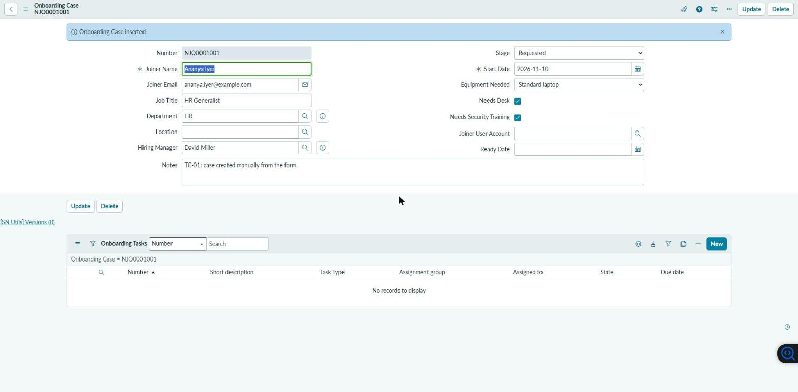
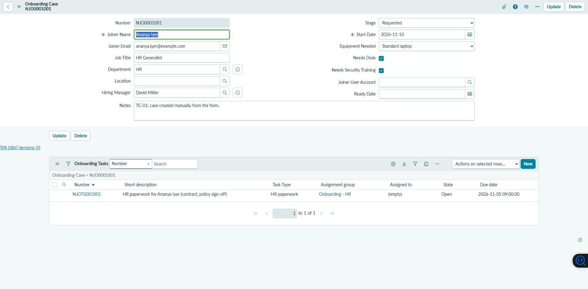
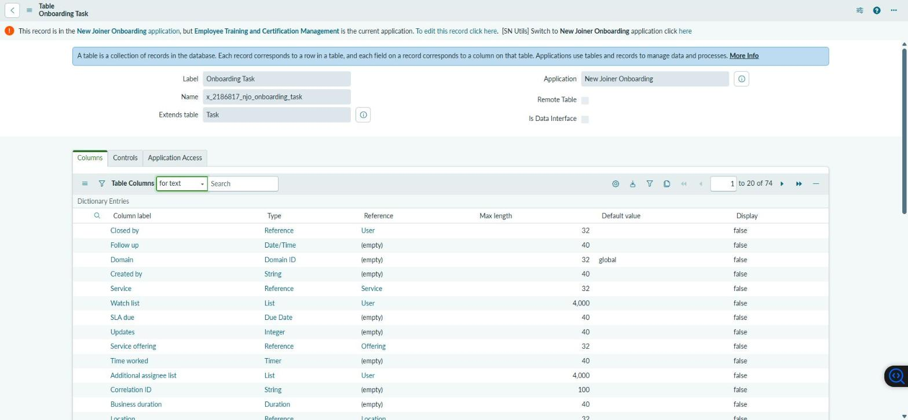
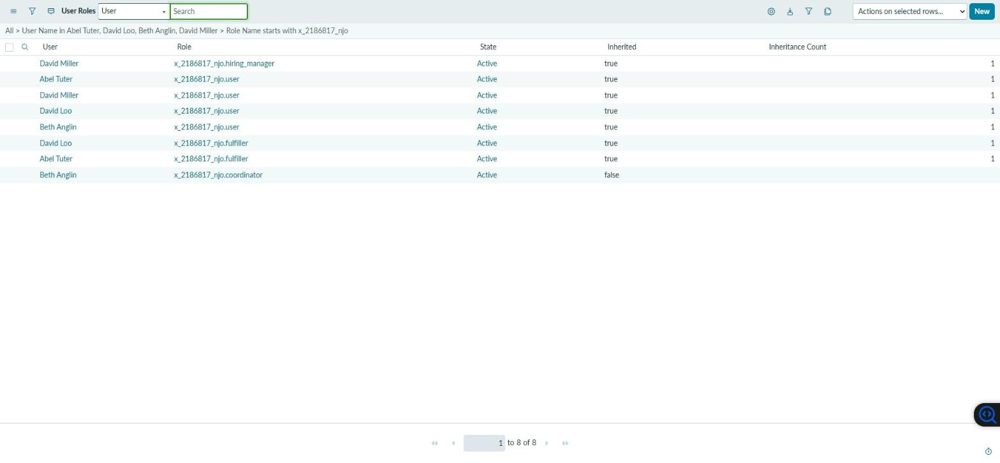
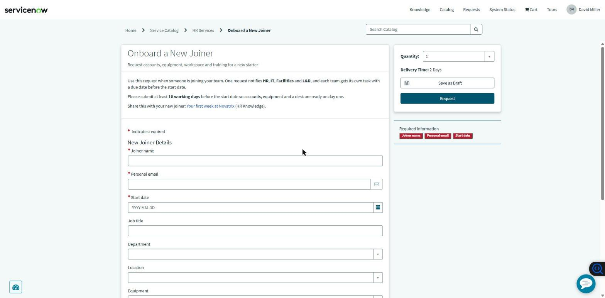
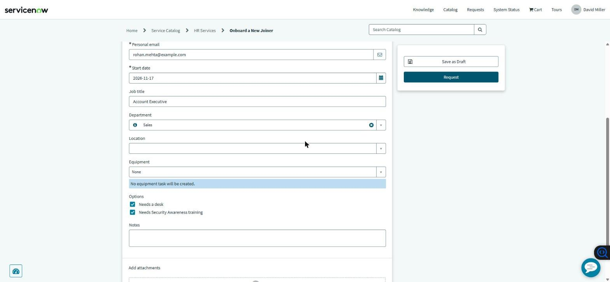
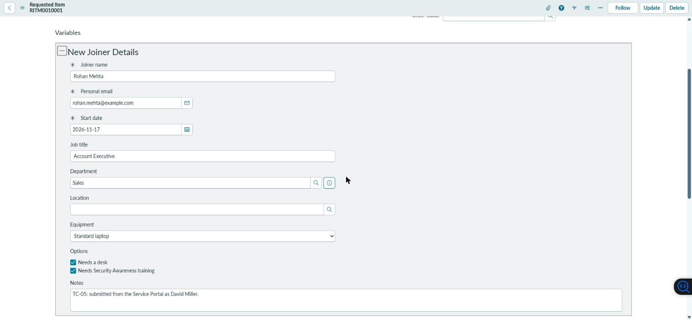
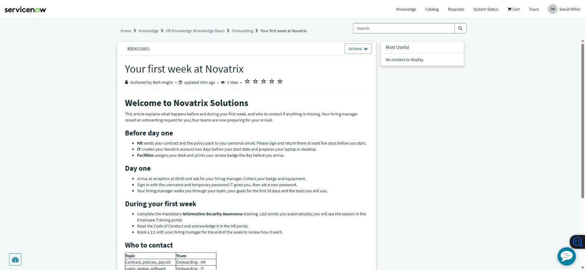

# New Joiner Onboarding Orchestrator (NJO) — ServiceNow

A **ServiceNow scoped application** that turns a hiring manager's single Service Portal request into coordinated onboarding work for **HR, IT, Facilities and L&D**, with SLAs, role-based access and a cross-app integration that enrols every new joiner in mandatory Security Awareness training in the [Employee Training and Certification Management (ETCMS)](https://github.com/sparsh17max/servicenow-employee-training-management) application.

Built **without code** — a CSA-focused project: Service Catalog, Flow Designer, Users/Groups/Roles, ACLs, SLA Definitions, Import Sets, Reports and Update Sets are all configuration. The only script is the standard one-line `gs.getUserID()` ACL condition.

- **Instance:** ServiceNow PDI (Zurich), branded for the fictional company *Novatrix Solutions*
- **Scope:** `x_2186817_njo`
- **Author:** Sparsh Varde

## Business scenario
When Novatrix hires someone, four teams each have to act before day one. Today the hiring manager chases them by email; joiners arrive without a login or a desk and nobody knows how long onboarding takes. NJO gives the request one record, fans it out into owned and timed tasks, and shows the state of every onboarding on a dashboard.

## Data model
| Table | Purpose |
|-------|---------|
| **Onboarding Case** `x_2186817_njo_onboarding_case` | One per new joiner — the container (`NJO0001001…`) |
| **Onboarding Task** `x_2186817_njo_onboarding_task` — *extends Task* | One per team action (`NJOT0001001…`); inherits State, Assignment group, SLA support |

Why the task extends Task but the case does not, and every field, is in [docs/data-dictionary.md](docs/data-dictionary.md).

## Progress
| Phase | Scope | Status |
|-------|-------|--------|
| 1 | Application, tables, groups, roles | ✅ Complete — TC-01…03 passed |
| 2 | Service Catalog item, variable set, Knowledge | ✅ Complete — TC-04…06 passed |
| 3 | Flow Designer orchestration + ETCMS integration | ⬜ |
| 4 | SLAs, notifications, ACLs | ⬜ |
| 5 | Import Set, dashboard, Update Set export, portfolio docs | ⬜ |

## Screenshots
| | |
|---|---|
|  |  |
| Onboarding Case with auto-number and default stage | Onboarding Tasks related list on the case |
|  |  |
| Onboarding Task extends Task | Roles inherited through groups |
|  |  |
| *Onboard a New Joiner* on the Service Portal | No-code catalog UI policy message |
|  |  |
| RITM with the variable set values | *Your first week at Novatrix* on the portal |

## Documentation
- [Development log](docs/development-log.md) — what / why / learned for each step, with issue tables
- [Test cases](docs/test-cases.md) — TC-01…TC-19
- [Data dictionary](docs/data-dictionary.md)
- [Changelog](CHANGELOG.md)
- [Project guide](docs/PROJECT-GUIDE.md)

## How this was built
Configuration was applied as Table API records from a local shell (session auth, see [scripts/README.md](scripts/README.md)) with the session scoped to the application and the *NJO v1.0* update set; tests and screenshots were done in the browser.
