# New Joiner Onboarding Orchestrator (NJO) — ServiceNow

A **ServiceNow scoped application** that turns a hiring manager's single Service Portal request into coordinated onboarding work for **HR, IT, Facilities and L&D**, with SLAs, role-based access and a cross-app integration that enrols every new joiner in mandatory Security Awareness training in the [Employee Training and Certification Management (ETCMS)](https://github.com/sparsh17max/servicenow-employee-training-management) application.

Built **without code** — a CSA-focused project: Service Catalog, Flow Designer, Users/Groups/Roles, ACLs, SLA Definitions, Import Sets, Reports and Update Sets are all configuration. There are no scripts: even the hiring-manager ACL, where a one-line `gs.getUserID()` condition is the usual answer, uses the condition builder's *is (dynamic) Me*.

- **Instance:** ServiceNow PDI (Zurich), branded for the fictional company *Novatrix Solutions*
- **Scope:** `x_2186817_njo`
- **Author:** Sparsh Varde

## Business scenario
When Novatrix hires someone, four teams each have to act before day one. Today the hiring manager chases them by email; joiners arrive without a login or a desk and nobody knows how long onboarding takes. NJO gives the request one record, fans it out into owned and timed tasks, and shows the state of every onboarding on a dashboard.

## Data model
| Table | Purpose |
|-------|---------|
| **Onboarding Case** `x_2186817_njo_onboarding_case` | One per new joiner — the container (`NJO0001001…`) |
| **Onboarding Task** `x_2186817_njo_onboarding_task` — *extends Task* | One per team action (`NJOT0001001…`); inherits State, Assignment group, SLA support |

Why the task extends Task but the case does not, and every field, is in [docs/data-dictionary.md](docs/data-dictionary.md).

## Progress
| Phase | Scope | Status |
|-------|-------|--------|
| 1 | Application, tables, groups, roles | ✅ Complete — TC-01…03 passed |
| 2 | Service Catalog item, variable set, Knowledge | ✅ Complete — TC-04…06 passed |
| 3 | Flow Designer orchestration + ETCMS integration | ✅ Complete — TC-07…11 passed (ETCMS writes run in ETCMS-scoped subflows) |
| 4 | SLAs, notifications, ACLs | ✅ Complete — TC-12…16 passed (no-script ACLs) |
| 5 | Import Set, dashboard, Update Set export, portfolio docs | ✅ Complete — TC-17…19 passed |

All 19 test cases pass.

## Screenshots
| | |
|---|---|
|  |  |
| Onboarding Case with auto-number and default stage | Onboarding Tasks related list on the case |
|  |  |
| Onboarding Task extends Task | Roles inherited through groups |
|  |  |
| *Onboard a New Joiner* on the Service Portal | No-code catalog UI policy message |
|  |  |
| RITM with the variable set values | *Your first week at Novatrix* on the portal |
| 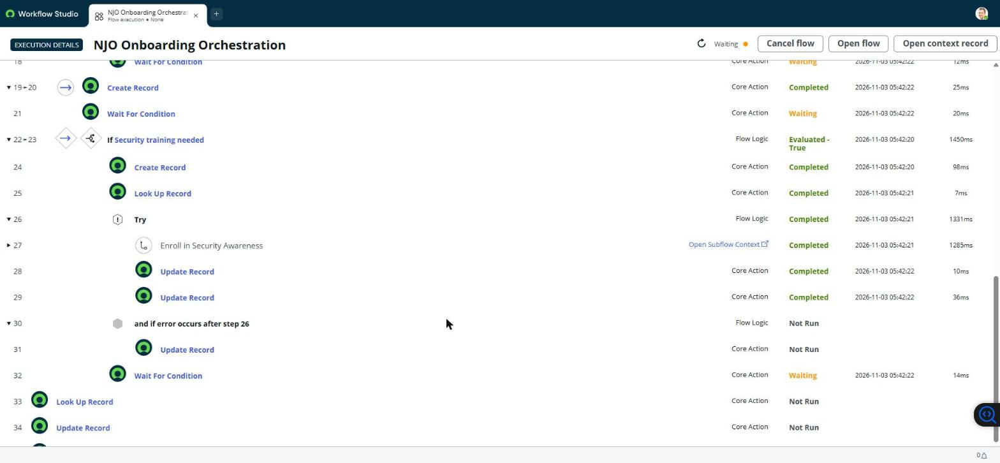 | 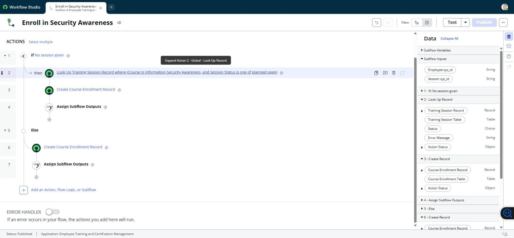 |
| Flow 1 run: the L&D path calls the ETCMS subflow inside Try | ETCMS-scoped subflow *Enroll in Security Awareness* |
| 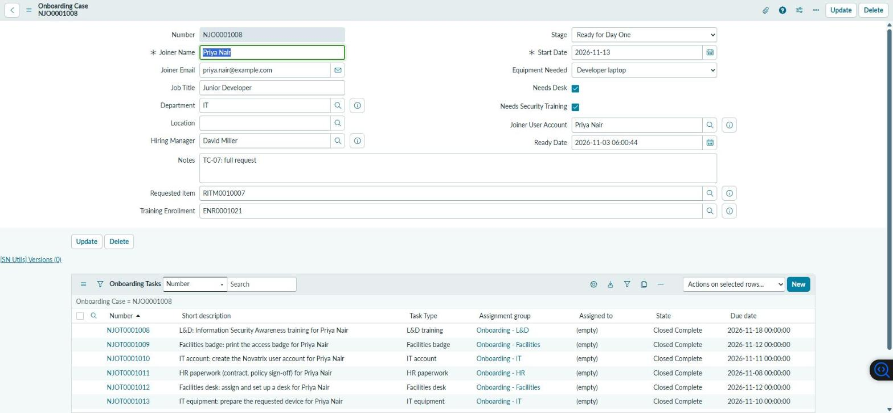 | 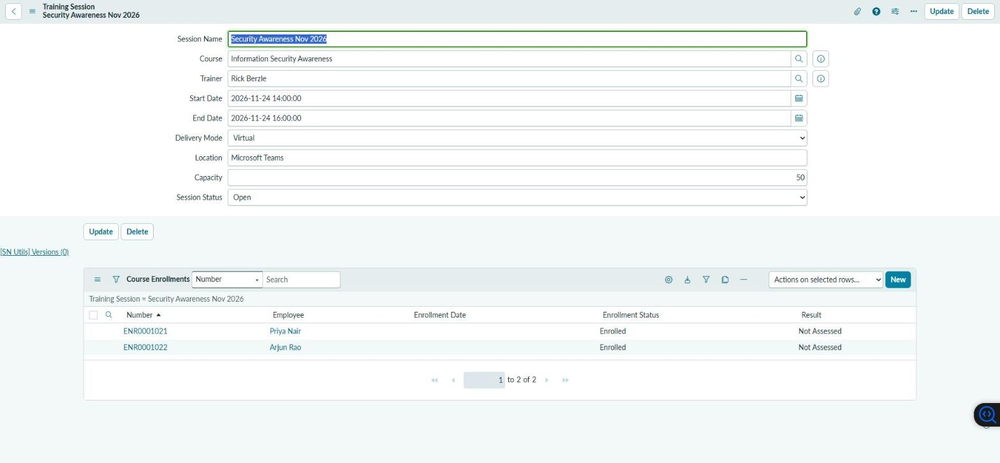 |
| Case Ready for Day One, all six tasks closed | New joiners in the ETCMS Security Awareness session |
| 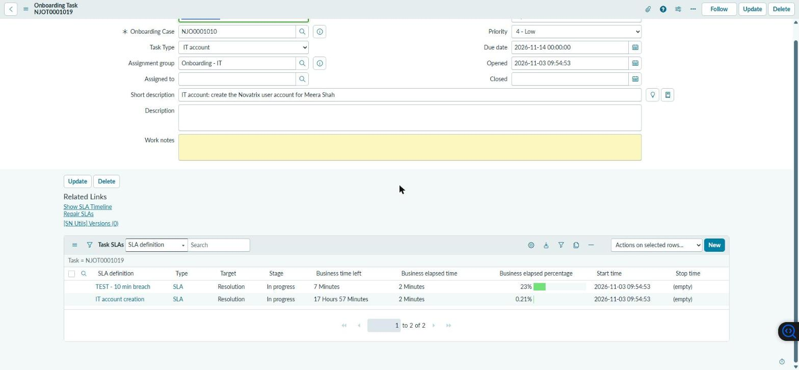 | 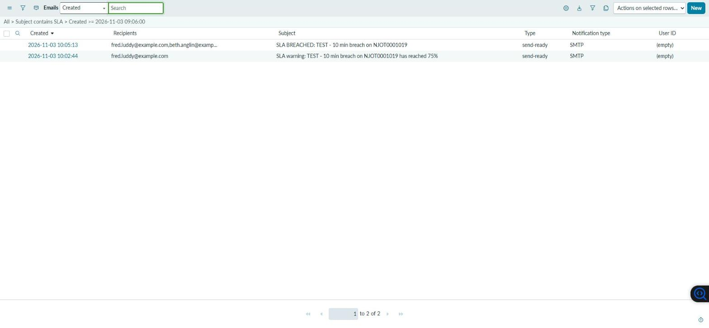 |
| Business-hours SLAs on an onboarding task | SLA 75% warning and breach emails from the SLA flow |
| 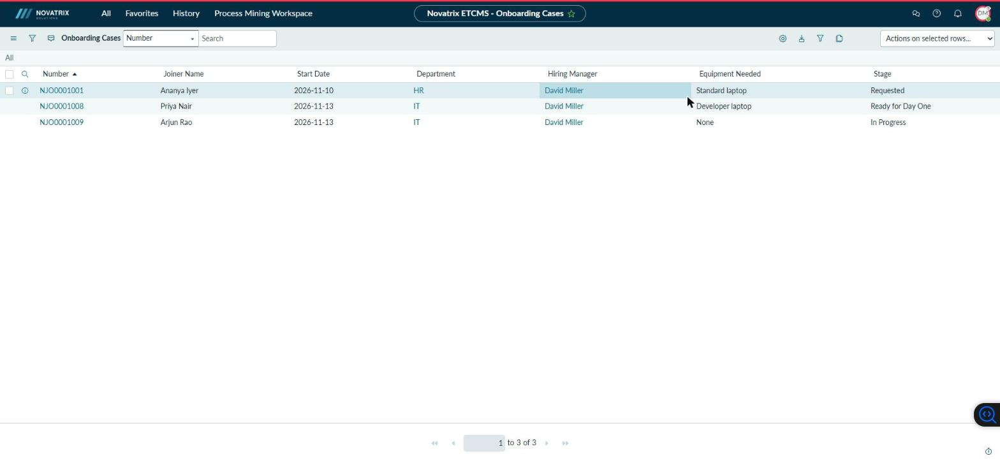 | 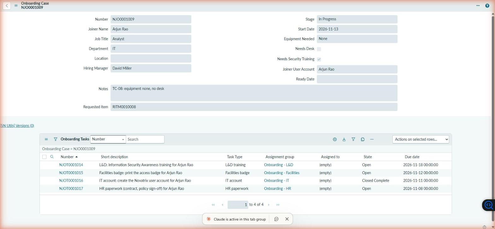 |
| Row ACL: a hiring manager sees only their own cases | Field ACL: Joiner Email hidden from hiring managers |
| 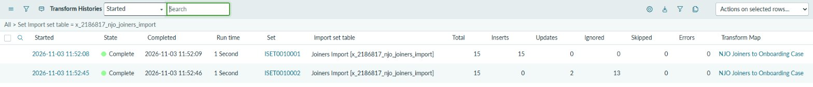 | 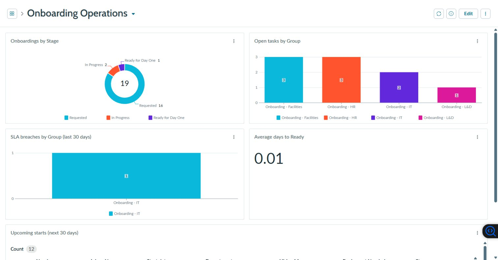 |
| Import, then re-import: 15 inserts, then 2 updates and 13 ignored | *Onboarding Operations* dashboard |
| 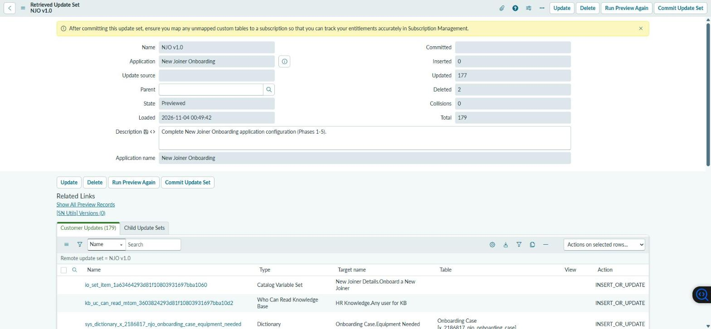 | |
| *NJO v1.0* retrieved and previewed: 179 updates, 0 problems | |

## Related project
**NJO enrols joiners into ETCMS.** The [Employee Training and Certification Management](https://github.com/sparsh17max/servicenow-employee-training-management) app owns courses, sessions and enrollments. NJO's L&D path enrols each new joiner in the next *Security Awareness* session, and its IT account flow links that enrollment to the new user. The writes run in two ETCMS-scoped subflows; see [docs/architecture.md](docs/architecture.md#integration-with-etcms).

## Install
The configuration is the update set [`update-sets/NJO-v1.0.xml`](update-sets/NJO-v1.0.xml), plus one dashboard XML. Steps, and what an update set does and does not carry, are in [update-sets/README.md](update-sets/README.md). Install ETCMS first.

## Documentation
- [Business requirements](docs/business-requirements.md) — BR-01…14 mapped to the build and the tests
- [Architecture](docs/architecture.md) — tables, flows, ETCMS integration, security model
- [Development log](docs/development-log.md) — what / why / learned for each step, with issue tables
- [Test cases](docs/test-cases.md) — TC-01…TC-19
- [Data dictionary](docs/data-dictionary.md)
- [Sample data](docs/sample-data/) — the joiners spreadsheets for the import set
- [Changelog](CHANGELOG.md)
- [Project guide](docs/PROJECT-GUIDE.md)

## How this was built
Much of the configuration was first applied as Table API records from a local shell (session auth, see [scripts/README.md](scripts/README.md)). Flows, ACLs, reports and the dashboard were built in the browser. Table API writes do not create update records on this instance, so everything created over REST was re-saved in the UI with *NJO v1.0* current before the export. The shell was also used for checks and test evidence.

## Known limitations
- Enrollments created by the ETCMS subflow have no *Enrollment Date*. A subflow has no trigger-date pill; the fix is a date input on the subflow.
- The update set preview was run on the source instance only (no second instance available).
