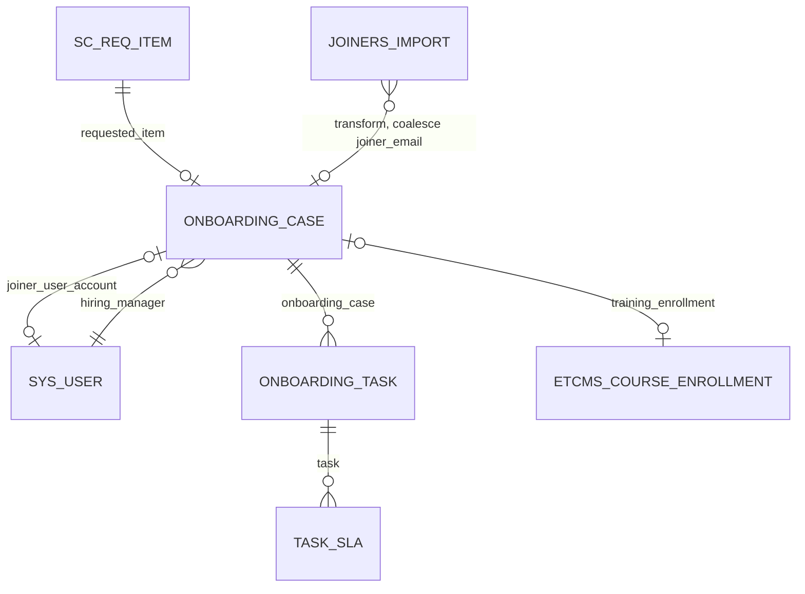
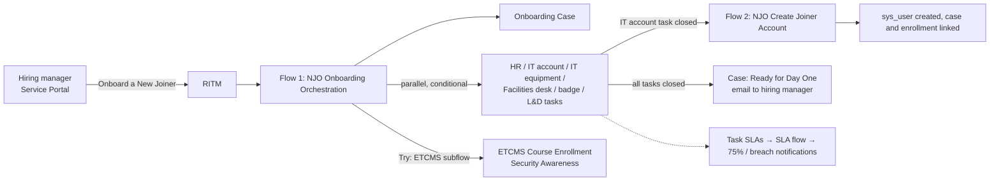

# Application Architecture

Application **New Joiner Onboarding**, scope `x_2186817_njo`. Field-level detail is in [data-dictionary.md](data-dictionary.md).

## Tables
| Table | Purpose | Key references |
|-------|---------|----------------|
| **Onboarding Case** `x_2186817_njo_onboarding_case` | One per new joiner (`NJO…`). The container record | Hiring Manager → `sys_user`, Department → `cmn_department`, Location → `cmn_location`, Requested Item → `sc_req_item`, Joiner User Account → `sys_user`, Training Enrollment → ETCMS Course Enrollment |
| **Onboarding Task** `x_2186817_njo_onboarding_task` extends **Task** | One per team action (`NJOT…`) | Onboarding Case |
| **Joiners Import** `x_2186817_njo_joiners_import` | Import set staging table (8 string columns) | — |

## Design decisions
- **Onboarding Task extends Task.** Extending Task brings State, Assignment group, Assigned to, work notes, SLA support and the standard task states for free.
- **Onboarding Case does not extend Task.** It is a container, not a work item. Keeping it separate means SLAs and assignment rules never fire on the parent.
- **The joiner is text until IT acts.** The joiner has no user record when the request is raised, so the case stores name and personal email. *Joiner User Account* is filled once Flow 2 creates the user.
- **Joiner Email is the natural key.** It is the coalesce field for imports and the input for the generated user ID.

## Process flow

| Automation | Trigger | Does |
|------------|---------|------|
| Flow *NJO Onboarding Orchestration* | Catalog item submitted | Creates the case and the tasks (due dates computed from the start date with no-code transforms), enrols the joiner in ETCMS, waits for all tasks to close, then sets Ready for Day One and emails the hiring manager |
| Flow *NJO Create Joiner Account* | IT account task closed complete | Creates the user (user ID from the email with Split transforms), links it to the case and to the ETCMS enrollment |
| Flow *NJO SLA Notifications* | Set as the Flow on every NJO SLA definition | 75% and 100% timers that fire the warning and breach notifications to the group manager (and the coordinator at breach) |
| ETCMS subflows *Enroll in Security Awareness*, *Link Enrollment to Employee* | Called from Flows 1 and 2 inside Try blocks | The ETCMS writes. They live in the ETCMS scope because an NJO-scoped flow cannot create or update ETCMS records on this instance |

## Integration with ETCMS
NJO enrols every joiner in the [ETCMS](https://github.com/sparsh17max/servicenow-employee-training-management) *Security Awareness* session. NJO reads ETCMS (Look Up the next session) directly with a cross-scope read privilege. It writes only through the two ETCMS-scoped subflows. If they fail, the flow adds a work note to the L&D task and the other onboarding paths continue.

## Security model
| Role | Granted via | Access |
|------|-------------|--------|
| `x_2186817_njo.hiring_manager` | group *Hiring Managers* | Read own cases (*Hiring Manager is (dynamic) Me*) and their tasks (dot-walked). No Joiner Email |
| `x_2186817_njo.fulfiller` | groups *Onboarding - HR / IT / Facilities / L&D* | Read all cases. Read/write tasks of *One of My Groups* |
| `x_2186817_njo.coordinator` | Beth Anglin | Read/write all cases and tasks |

Nine ACLs, all from the condition builder; none uses a script.

## Reporting
The *Onboarding Operations* dashboard holds five reports: by stage (donut), open tasks by group (bar), SLA breaches by group over the last 30 days (bar on `task_sla`), average days to ready (single score over the *Days to Ready* function field) and upcoming starts (list).
